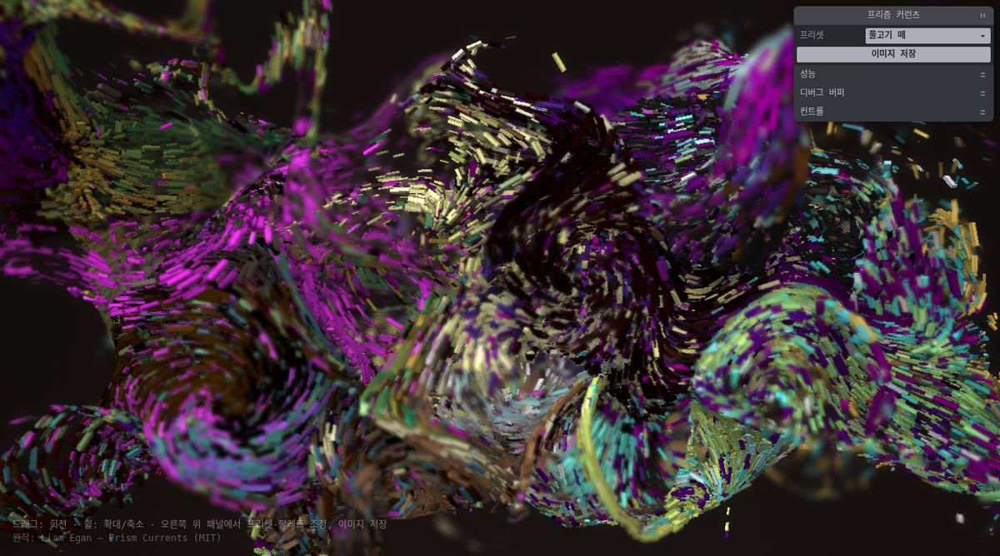
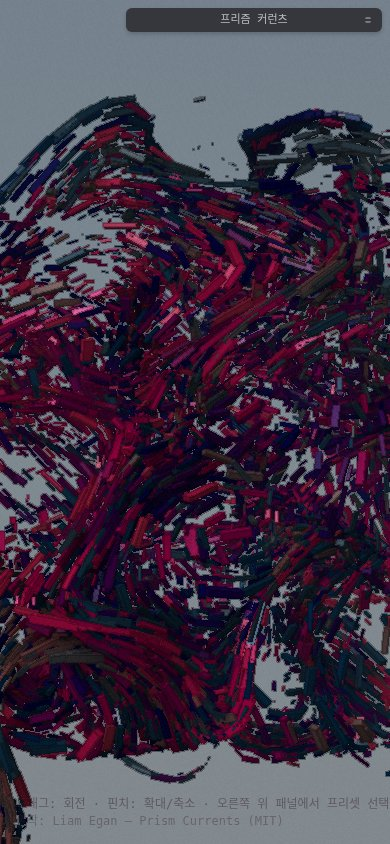

# 프리즘 커런츠 (Prism Currents) — 한국어판

수만 개의 프리즘이 흐름장을 따라 유영하며 빛을 산란시키는 WebGL2 인터랙티브 아트입니다.

**라이브 데모: https://sigco3111.github.io/prism-currents/**




## 원작 및 라이선스

- 원작: [Prism Currents](https://codepen.io/shubniggurath/pen/01a164e2-494a-79a0-948d-59baebda2dc9) — Liam Egan ([@shubniggurath](https://codepen.io/shubniggurath))
- 원작 라이선스: MIT (Copyright (c) 2026 Liam Egan) — [LICENSE](LICENSE)
- 이 저장소는 원작의 MIT 라이선스 조건에 따라 한국어화 및 개선 사항을 더해 배포하는 포크입니다.
- 사용된 오픈소스 라이브러리의 고지: [THIRD-PARTY-NOTICES.md](THIRD-PARTY-NOTICES.md)

## 한국어판 변경 사항

- **전체 UI 한글화**: 컨트롤 패널(약 40개 라벨), 프리셋 16개(황금 물살, 한복판, 물고기 떼, 건반, 누아르 등), 팔레트 스킴 18개, 디버그 버퍼 라벨, 페이지 타이틀, 저장 이미지 파일명
- **조작 안내 추가**: 원작에 없던 안내 문구를 하단에 표시 (데스크톱/모바일 자동 분기), 원작 크레딧 상시 표기
- **모바일 품질 조정**: 터치 기기에서 프리즘 개수 100,000 → 30,000, 렌더링 해상도(DPR) 상한 2 → 1.5로 낮춰 발열과 배터리 소모 완화
- **의존성 자체 서빙**: 외부 CDN(esm.sh) 대신 `vendor/` 디렉터리에서 직접 서빙 — 인터넷 환경과 CDN 상태에 영향을 받지 않음

## 조작법

### 데스크톱
- **드래그**: 시점 회전
- **휠**: 확대/축소
- **오른쪽 위 패널**: 프리셋 선택, 팔레트/흐름/형상/카메라/분위기 조정, 이미지 저장

### 모바일
- **드래그**: 시점 회전
- **핀치**: 확대/축소
- **오른쪽 위 패널**: 프리셋 선택 및 각종 조정

## 주요 기능

- 프리셋 16종: 선택하면 카메라와 설정이 부드럽게 전환
- 팔레트: 18종의 색상 스킴을 두 개의 팔레트 슬롯에 적용, 시드 재생성(다시 굴리기), 전환 주기 설정
- 형상: 슬라브/구/토러스/캡슐/파도 시트
- 흐름: 컬 노이즈 기반 유속장, 회전(소용돌이), 상승/하강
- 카메라: 피사계심도(DOF), 자동 회전
- 분위기: 배경 안개, 다크 모드
- 디버그 버퍼: 위치/속도/나이/시드 등 시뮬레이션 버퍼 시각화
- 이미지 저장: 현재 프레임을 PNG로 다운로드

## 기술 스택

- WebGL2 (GPU 연산 — 변환 피드백 기반 파티클 시뮬레이션)
- [wtc-gl](https://github.com/wethegit/wtc-gl) + [wtc-math](https://github.com/wethegit/wtc-math) (MIT, Liam Egan)
- [tweakpane](https://github.com/cocopon/tweakpane) (MIT, cocopon) — 컨트롤 패널
- [earcut](https://github.com/mapbox/earcut) (ISC, Mapbox) — 다각형 삼각분할
- 빌드 도구 없음: 순수 HTML/JS, GitHub Pages 정적 호스팅

## 디렉터리 구조

```
index.html          페이지 진입점 (한글 UI, 힌트, 크레딧)
src/main.js         시뮬레이션/렌더링 메인 (모바일 품질 조정 포함)
src/controls.js     컨트롤 패널 정의 (한글)
src/palettes.js     팔레트 스킴 18종 (한글 이름)
src/presets.js      프리셋 16종 (한글 이름)
src/shaders/        GLSL 셰이더 6종 (원본 유지)
vendor/             의존 라이브러리 자체 서빙
LICENSE             원작 MIT 라이선스
THIRD-PARTY-NOTICES.md  서드파티 라이선스 고지
```

## 로컬 실행

정적 파일만으로 동작합니다. ES 모듈 때문에 로컬 서버가 필요합니다.

```bash
python3 -m http.server 8000
# http://localhost:8000 접속
```
